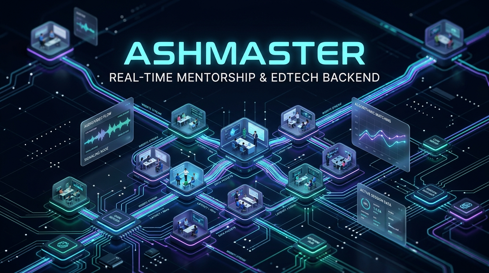

# 🎓 Ashmaster — Real-Time Mentorship & Tutoring Platform



<p align="center">
  <a href="https://www.postman.com/shahjalal-backend-9458759/shahjalal-api-portfolio/collection/48491387-ae2a5410-d868-41ce-bbe0-e31a3f0cb892" target="_blank">
    
  </a>
  <a href="https://www.postman.com/shahjalal-backend-9458759/shahjalal-api-portfolio/collection/48491387-ae2a5410-d868-41ce-bbe0-e31a3f0cb892" target="_blank">
    
  </a>
</p>

<p align="center">
  
  
  
  
  
  
  
  
</p>

---

## 📌 Executive Overview

Ashmaster connects students with expert industry mentors for scheduled 1-on-1 tutoring, code reviews, and live video learning sessions. Features bi-directional WebSockets for real-time signaling, automated calendar scheduling, and escrow-style tutor payouts.

---

## 🚀 Key Architectural Highlights

- **Real-Time Signaling**: WebSocket messaging layer for live session handshakes and notifications.
- **Session Booking**: Smart schedule matching between mentor availability calendars and student timezones.
- **Progress Telemetry**: Milestone tracking, homework submissions, and session review feedback.
- **Escrow Payments**: Stripe payment hold and release upon confirmed session completion.
- **Role-Based Security**: Strict access control for Mentors, Students, and Educational Admins.

---

## 📬 API Documentation & Interactive Postman Collection

The complete REST API specification is published in our public Postman showcase workspace:

* 🌐 **Instant Live API Documentation**: [Explore ashmaster-backend in Postman (Instant Web View)](https://www.postman.com/shahjalal-backend-9458759/shahjalal-api-portfolio/collection/48491387-ae2a5410-d868-41ce-bbe0-e31a3f0cb892)
* 📁 **Local Postman File**: [`docs/postman_collection.json`](./docs/postman_collection.json) (import directly into Postman Desktop or Newman CLI).

### Core Endpoint Modules

| Module | Base Route | Key Capabilities |
|---|---|---|
| **Authentication** | `/api/v1/auth` | Student & Mentor registration, credential verification |
| **Mentors** | `/api/v1/mentor` | Mentor profiles, hourly rates, verified expertise, calendar |
| **Sessions** | `/api/v1/session` | Book tutoring slots, video room tokens, session completion |
| **Reviews** | `/api/v1/review` | Session feedback, rating aggregation, and endorsements |
| **Payments** | `/api/v1/payment` | Stripe payment capture, mentor payout distribution |

---

## 📂 Project Architecture

```plaintext
ashmaster-backend/
├── assets/
│   └── banner.*                 # Project architecture visual banner
├── docs/
│   └── postman_collection.json  # Full Postman API collection v2.1
├── src/
│   ├── app/
│   │   ├── middlewares/         # Global error handlers, auth & validation guards
│   │   ├── modules/             # Domain-driven feature modules
│   │   └── routes/              # Centralized route aggregator
│   ├── config/                  # Environment & external service configurations
│   └── server.ts                # Application bootstrapper & HTTP server
├── prisma/
│   └── schema.prisma            # Database schema definition
├── .env.example                 # Sanitized environment template
├── package.json
└── tsconfig.json
```

---

## 🛠️ Quickstart & Local Setup

### Prerequisites
* **Node.js**: `v20.x` or higher
* **Database**: MongoDB or PostgreSQL (as specified in `schema.prisma`)

### 1. Clone & Install Dependencies
```bash
git clone https://github.com/shahjalal-labs/ashmaster-backend.git
cd ashmaster-backend
npm install
```

### 2. Environment Configuration
Copy the provided `.env.example` file to create your local `.env`:
```bash
cp .env.example .env
```

### 3. Initialize Prisma Client
```bash
npx prisma generate
```

### 4. Run Development Server
```bash
npm run dev
```

---

## 👨‍💻 Engineering & Authorship

Developed and maintained by **Md. Shahjalal**.

* **GitHub**: [@shahjalal-labs](https://github.com/shahjalal-labs)
* **Email**: [muhommodshahjalal@gmail.com](mailto:muhommodshahjalal@gmail.com)

---

## 📄 License

This project is licensed under the [ISC License](LICENSE).
